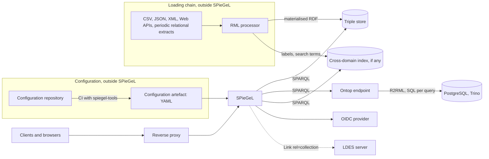
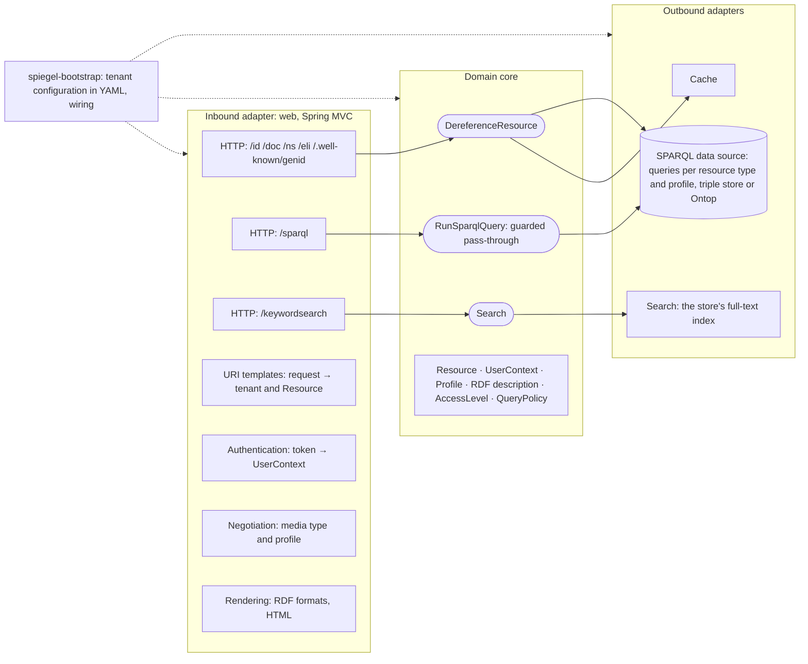

# Hexagonal design

SPieGeL uses a hexagonal architecture (ports and adapters). The domain core holds the rules of a request that depend neither on HTTP nor on SPARQL, in a domain model of its own. The predecessor spreads such rules over scripts, templates and an XML catalogue. Which URI template matches a request belongs to the web adapter, and which queries describe a resource belongs to the SPARQL adapter. The core depends only on interfaces (ports). Everything technology-specific lives in adapters.

!!! note "Status"
    This is the design as proposed by the analysis. Choices that need a formal decision will be recorded as [ADRs](../../adr/README.md).

## Context

SPieGeL reads RDF from data sources, which are SPARQL endpoints (FR-DS-01). Whether it may also read a file such as HDT in-process is [open question 29](../06-open-questions.md#architecture-and-operations). A triple store holds RDF that is loaded into it, including RDF that the loading chain has materialised from non-RDF sources with RML. A relational source that must be current is translated per request by Ontop, which offers its own SPARQL endpoint, so SPieGeL reads it like a store ([ADR 0009](../../adr/0009-ontop-for-relational-sources.md)).

The portal and its federated SPARQL editor are pages of the umbrella domain's tenant, not separate services; the editor's queries run in the visitor's browser ([ADR 0025](../../adr/0025-federated-query-in-the-portal.md)). An index of data from several domains, such as labels or search terms, is never held by SPieGeL: it is a store of its own, filled by the loading chain, and read like any data source. Tools for writing and checking configuration are a separate artefact, `spiegel-tools` ([ADR 0026](../../adr/0026-system-boundary.md)).

## Ports and adapters

Solid arrows are calls into or from a use case. The ports, in both directions, speak the core's own [domain model](#domain-model).

**The web adapter turns a request into the domain model.** `spiegel-adapter-in-rest` is implemented with Spring MVC. Before it calls a use case, it:

1. selects the tenant, by host name or by the path of the request, as the tenant configuration says;
2. matches the request against the tenant's URI templates. The matching template leads to a specific configuration within the tenant, and the adapter answers the `303` from an `id` to its `doc` URI itself;
3. creates a `Resource` from the match;
4. creates a `UserContext` with Spring Security, from the caller's token (phase 2);
5. negotiates the media type and the profile, from a query parameter and/or a header.

It then calls the use case with the `Resource`, the `Profile` and the `UserContext`, and renders the RDF description that comes back in the negotiated media type, with Jena RIOT for RDF formats and a template engine for HTML. Authentication and rendering are not ports of the core and not adapters of their own: they are part of the web adapter. The core knows no URI templates, no HTTP and no formats.

**The SPARQL adapter knows the queries.** For a `Resource` and a `Profile`, `spiegel-adapter-out-virtuoso` looks up in its configuration which queries describe that resource, binds the resource IRI into them, runs them on the configured data source and returns one RDF description. The core does not know the queries.

**The tenant configuration is not an adapter.** `spiegel-bootstrap` binds it from YAML with Spring (`@ConfigurationProperties`) and gives each module the part it needs when it wires the application (the dotted arrows): the web adapter gets the tenants, their URI templates and profiles, and the SPARQL adapter gets the data sources and the queries per resource type and profile. Each adapter defines the configuration types it needs, because adapters do not depend on `spiegel-bootstrap`. The core neither reads the configuration nor calls a port for it ([ADR 0028](../../adr/0028-tenant-configuration-in-yaml.md)).

The order in which these parts act on a request is described in [Request flow](request-flow.md).

## Domain model

The core has a domain model of its own: a set of Java classes used by the inbound ports (the use cases that adapters call) and by the outbound ports (the interfaces that adapters implement). It includes at least:

| Concept | Responsibility |
|---|---|
| `Resource` | A structured identifier of a resource: the tenant id, the key of the configuration within the tenant that the web adapter found through the URI template (the resource type), the values of the template's variables, and the resource IRI. It holds enough for an outbound adapter to map it back to the specific configuration within the tenant. |
| `UserContext` | The username and the roles of an authenticated caller, created by the web adapter with Spring Security. Empty for an unauthenticated caller, who has the *public* level. |
| `Profile` | A named view of a resource (for example *summary* or *full*), negotiated per Content Negotiation by Profile. |
| RDF description | The merged RDF result, independent of format. Whether it is Jena's `org.apache.jena.rdf.model.Model`, Jena's `Graph` or `org.apache.commons.rdf.api.Graph` is still to be decided ([ADR 0010](../../adr/0010-jena-graph-types-in-the-core.md), [open question 14](../06-open-questions.md#architecture-and-operations)). |
| `AccessLevel` | An ordered type (*public* < *internal* < *confidential* < *secret* < *top secret*). The caller's level is the highest level among their roles. Whether the core derives it from the `UserContext`, or only an outbound adapter needs it and maps the roles itself, is [open question 44](../06-open-questions.md#architecture-and-operations). |
| `QueryPolicy` | What a query on `/sparql` may do: the allowed query forms, and no `SERVICE`. It names no graphs; the store decides what a level sees ([ADR 0011](../../adr/0011-query-policy.md)). |

Tenants, URI templates, resource types, data sources and queries are not part of the domain model. They are configuration of the adapters that use them, bound by `spiegel-bootstrap` ([ADR 0028](../../adr/0028-tenant-configuration-in-yaml.md)).

Use cases (inbound ports):

- **`DereferenceResource`**: given a `Resource`, a `Profile` and a `UserContext`, return the RDF description, a redirect for a moved resource (`301`), a tombstone (`410`), or "not found".
- **`RunSparqlQuery`**: run a read-only query for a tenant on behalf of a `UserContext`, on the one data source the tenant names for `/sparql`. This is a guarded pass-through rather than domain logic: the core does not interpret the query, but checks it against the `QueryPolicy` through the `QueryInspector` port, and applies the bounded pool, the timeout and the result limit.
- **`Search`**: keyword search for a tenant on behalf of a `UserContext`.

Outbound ports:

| Port | Adapters |
|---|---|
| `DataSourcePort` | Describes a `Resource` for a `Profile` and a caller: SPARQL over HTTP (Jena), for triple stores and for Ontop endpoints over relational sources ([ADR 0009](../../adr/0009-ontop-for-relational-sources.md)). The adapter chooses the queries from its configuration and runs them with the credentials for the caller's level |
| `QueryInspector` | Checks query text against a `QueryPolicy`: strict SPARQL 1.1 parsing and a walk over the syntax tree, in `spiegel-adapter-out-virtuoso` ([ADR 0011](../../adr/0011-query-policy.md)) |
| `SearchPort` | The data source's own full-text index through SPARQL, such as `bif:contains` or `ql:contains-word` (FR-SRCH-01) |
| `CachePort` | In-memory; later a shared cache. The key is built from the `Resource`, the `Profile` and the caller's level (NFR-SEC-03); how the level is known follows open question 44 |
| `RateLimitPort` | In memory per node, each counting up to its share of the limit; later a shared store, falling back to the count per node when it fails ([ADR 0022](../../adr/0022-edge-concerns.md)) |

## Mapping from the predecessor

| Predecessor concept | SPieGeL equivalent | Note |
|---|---|---|
| Java accessor | Adapter (inbound or outbound) | Usually a direct translation |
| Scripts for `/doc`, `/ns`, `/sparql` and search | Use cases in the core | Currently mix caching, security and domain logic; to be separated |
| Routes generated at runtime per domain | URI templates in the web adapter, with the tenant selected by host name or path | No per-domain code |
| XML query catalogue and query templates | Queries per resource type and profile, in the configuration of the SPARQL adapter | The most hidden business logic of the predecessor. Now configured and tested |
| RDF serialisation | Web adapter (`spiegel-adapter-in-rest`, Jena RIOT) | — |
| XSLT HTML rendering | Web adapter (`spiegel-adapter-in-rest`) | Template engine to be decided |
| File-based second-level cache | `CachePort` | The key includes the access level and profile (NFR-SEC-03) |
| OIDC flow scripts | Spring Security OAuth2 resource server / client in the web adapter, producing a `UserContext` | Large simplification |
| Environment variables → configuration | `@ConfigurationProperties` in `spiegel-bootstrap`, for the application and for the tenant configuration in YAML | [ADR 0028](../../adr/0028-tenant-configuration-in-yaml.md) |
| Concurrency throttle | Bounded executor or bulkhead per data source | NFR-OPS-02 |

## Rules that keep the core clean

- The core has **no** dependency on Spring, servlet APIs, Jena's HTTP client or any template engine. Which RDF type it uses is still to be decided ([ADR 0010](../../adr/0010-jena-graph-types-in-the-core.md)); whichever it is, the core uses nothing from `jena-arq`: it neither parses nor runs SPARQL, nor reads or writes RDF formats.
- The core knows no URI templates and no queries. They belong to the web adapter and the SPARQL adapter.
- Adapters depend on the core; the core never depends on adapters.
- Authorisation is part of the use case, not of a filter that can be bypassed by a cache hit (NFR-SEC-03).
