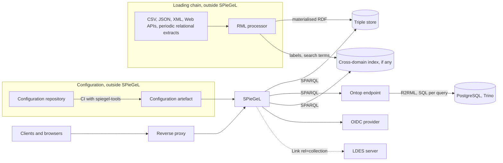
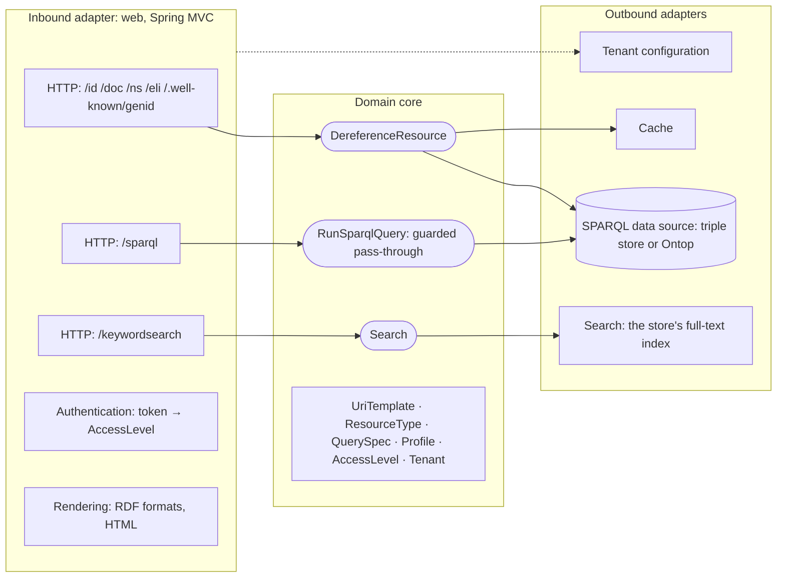

# Hexagonal design

SPieGeL uses a hexagonal architecture (ports and adapters). The domain core holds the rules that the predecessor spreads over scripts, templates and an XML catalogue. These rules include which URI template matches, which queries describe a resource, which profile applies, and which access level a caller has. The core depends only on interfaces (ports). Everything technology-specific lives in adapters.

!!! note "Status"
    This is the design as proposed by the analysis. Choices that need a formal decision will be recorded as [ADRs](../../adr/README.md).

## Context

SPieGeL reads RDF from data sources, which are SPARQL endpoints (FR-DS-01). Whether it may also read a file such as HDT in-process is [open question 29](../06-open-questions.md#architecture-and-operations). A triple store holds RDF that is loaded into it, including RDF that the loading chain has materialised from non-RDF sources with RML. A relational source that must be current is translated per request by Ontop, which offers its own SPARQL endpoint, so SPieGeL reads it like a store ([ADR 0009](../../adr/0009-ontop-for-relational-sources.md)).

The portal and its federated SPARQL editor are pages of the umbrella domain's tenant, not separate services; the editor's queries run in the visitor's browser ([ADR 0025](../../adr/0025-federated-query-in-the-portal.md)). An index of data from several domains, such as labels or search terms, is never held by SPieGeL: it is a store of its own, filled by the loading chain, and read like any data source. Tools for writing and checking configuration are a separate artefact, `spiegel-tools` ([ADR 0026](../../adr/0026-system-boundary.md)).

## Ports and adapters

Solid arrows are calls from a use case. The dotted arrow is a call that the inbound adapter makes through a port of the core before the use case: it resolves the tenant first (see [Request flow](request-flow.md)).

Authentication and rendering are not ports of the core and not adapters of their own. They belong to the web adapter, `spiegel-adapter-in-rest`, which is implemented with Spring MVC: it validates the caller's token with Spring Security and maps the caller's roles to an `AccessLevel` before it calls the use case, and it renders the `ResourceDescription` that the use case returns in the negotiated media type, with Jena RIOT for RDF formats and a template engine for HTML. The use cases receive the tenant and the access level as input; they do not know how the caller was authenticated, nor in which format the result is written.

The order in which these parts act on a request is described in [Request flow](request-flow.md).

## Domain core

| Concept | Responsibility |
|---|---|
| `Tenant` | A domain: host names, data sources (one of them named for `/sparql`), licence, language priority, URI templates, profiles, HTML theme. Read from Turtle by the configuration adapter; the core never sees Turtle ([ADR 0012](../../adr/0012-tenant-configuration-as-rdf.md)). |
| `DataSource` | A named SPARQL endpoint for one access level, with a key to its credentials and a declaration whether it enforces graph permissions ([ADR 0011](../../adr/0011-query-policy.md)). |
| `UriTemplate` | A path pattern with variables typed by a pattern, and the `ResourceType` it identifies. Also models the `id` → `doc` relation and the `303`. A tenant normally has one generic template for every concept, plus optional, more specific templates for exceptions ([ADR 0012](../../adr/0012-tenant-configuration-as-rdf.md)). |
| `ResourceType` | What kind of resource a template yields, and which `QuerySpec`s describe it. |
| `QuerySpec` | A query (stored as data), the data source it runs on, and the conditions (profile, media type) under which it runs. Replaces the predecessor's XML query catalogue. |
| `Profile` | A named view of a resource (for example *summary* or *full*), negotiated per Content Negotiation by Profile. |
| `AccessLevel` | An ordered type (*public* < *internal* < *confidential* < *secret* < *top secret*). The caller's level is the highest level among their roles. |
| `ResourceDescription` | The merged RDF result, independent of format: a Jena `Graph` ([ADR 0010](../../adr/0010-jena-graph-types-in-the-core.md)). |
| `QueryPolicy` | What a query may do: the allowed query forms, and no `SERVICE`. Applied to every query on `/sparql` and to every tenant query when the configuration is loaded. It names no graphs; the store decides what a level sees ([ADR 0011](../../adr/0011-query-policy.md)). |

Use cases (inbound ports):

- **`DereferenceResource`**: given a tenant, a path, the negotiated media type and profile, and the caller's access level, return a `ResourceDescription`, a redirect (`303` from `id` to `doc`, or `301` for a moved resource), a tombstone (`410`), or "not found".
- **`RunSparqlQuery`**: run a read-only query for a tenant at the caller's access level, on the one data source the tenant names for `/sparql`. This is a guarded pass-through rather than domain logic: the core does not interpret the query, but checks it against the `QueryPolicy` through the `QueryInspector` port, and applies the access level, the bounded pool, the timeout and the result limit.
- **`Search`**: keyword search for a tenant at the caller's access level.

Outbound ports:

| Port | Adapters |
|---|---|
| `DataSourcePort` | SPARQL over HTTP (Jena), for triple stores and for Ontop endpoints over relational sources ([ADR 0009](../../adr/0009-ontop-for-relational-sources.md)) |
| `QueryInspector` | Checks query text against a `QueryPolicy`: strict SPARQL 1.1 parsing and a walk over the syntax tree, in `spiegel-adapter-out-virtuoso` ([ADR 0011](../../adr/0011-query-policy.md)) |
| `SearchPort` | The data source's own full-text index through SPARQL, such as `bif:contains` or `ql:contains-word` (FR-SRCH-01) |
| `TenantConfigurationPort` | Turtle in SPieGeL's configuration vocabulary, validated with SHACL, with `.rq` files for queries ([ADR 0012](../../adr/0012-tenant-configuration-as-rdf.md)). Delivered as a versioned artefact, mounted read-only ([ADR 0013](../../adr/0013-tenant-configuration-delivery.md)) |
| `CachePort` | In-memory; later a shared cache |
| `RateLimitPort` | In memory per node, each counting up to its share of the limit; later a shared store, falling back to the count per node when it fails ([ADR 0022](../../adr/0022-edge-concerns.md)) |

## Mapping from the predecessor

| Predecessor concept | SPieGeL equivalent | Note |
|---|---|---|
| Java accessor | Adapter (inbound or outbound) | Usually a direct translation |
| Scripts for `/doc`, `/ns`, `/sparql` and search | Use cases in the core | Currently mix caching, security and domain logic; to be separated |
| Routes generated at runtime per domain | One set of controllers with `Tenant` resolved from the host name | No per-domain code |
| XML query catalogue and query templates | `ResourceType` + `QuerySpec` + `Profile` | The most hidden business logic of the predecessor. Now typed and tested |
| RDF serialisation | Web adapter (`spiegel-adapter-in-rest`, Jena RIOT) | — |
| XSLT HTML rendering | Web adapter (`spiegel-adapter-in-rest`) | Template engine to be decided |
| File-based second-level cache | `CachePort` | The key includes the access level and profile (NFR-SEC-03) |
| OIDC flow scripts | Spring Security OAuth2 resource server / client in the web adapter | Large simplification |
| Environment variables → configuration | `@ConfigurationProperties` + tenant configuration files | — |
| Concurrency throttle | Bounded executor or bulkhead per data source | NFR-OPS-02 |

## Rules that keep the core clean

- The core has **no** dependency on Spring, servlet APIs, Jena's HTTP client or any template engine. It uses Jena's graph types (`Graph`, `Node`, `Triple` from `jena-core`), so that descriptions can be merged without conversion, but nothing from `jena-arq`: it neither parses nor runs SPARQL, nor reads or writes RDF formats ([ADR 0010](../../adr/0010-jena-graph-types-in-the-core.md)).
- Adapters depend on the core; the core never depends on adapters.
- Authorisation is part of the use case, not of a filter that can be bypassed by a cache hit (NFR-SEC-03).
