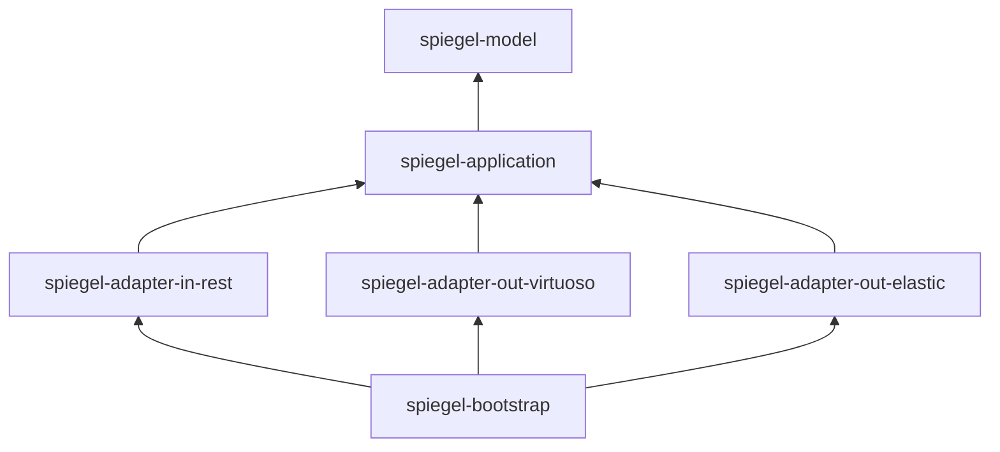

# Module structure

The proposed Maven module layout follows the [hexagonal design](hexagonal-design.md). Each adapter is its own module, so that its dependencies cannot leak into the core.

```
spiegel/                                 (parent POM, packaging pom)
├── spiegel-model                        Domain model and its exceptions. No Spring.
├── spiegel-application                  Use cases (i.e. inbound ports), outbound ports, services implementing use cases and using outbound ports. No Spring.
├── spiegel-adapter                      (packaging pom)
│   ├── spiegel-adapter-in               (packaging pom) adapters that drive the application
│   │   └── spiegel-adapter-in-rest      HTTP inbound: dereferencing, 303, content negotiation, Spring MVC
│   └── spiegel-adapter-out              (packaging pom) adapters behind the outbound ports
│       ├── spiegel-adapter-out-virtuoso ResourceRepository over SPARQL 1.1 against Virtuoso, using Apache Jena
│       └── spiegel-adapter-out-elastic  outbound adapter for Elasticsearch
└── spiegel-bootstrap                    Spring Boot application: wiring, caching, health, packaging
```

Planned modules, added when they are needed:

```
spiegel-adapter-out-config               TenantConfigurationPort: Turtle + .rq files, SHACL validation (jena-shacl)
spiegel-adapter-out-html                 RendererPort for HTML (template engine, Flux design system, front-end build)
spiegel-adapter-out-security             IdentityPort: OIDC, roles → AccessLevel
spiegel-tools                            command-line tools for configuration and CI: context generator,
                                         vocabulary extractor, configuration validator
```

The package layout per module is listed in [Project modules](project-modules.md).

## Dependency rules



- `spiegel-model` depends on nothing in this project, and only on a minimal set of libraries.
- `spiegel-application` depends on `spiegel-model` only. It holds the use cases (`port.in`), the ports to the outside world (`port.out`) and the services that implement the use cases. It has no Spring dependency: `spiegel-bootstrap` creates its services as beans.
- Adapters depend on `spiegel-application` and `spiegel-model` only, never on each other.
- `spiegel-tools` will not be part of the server. It reuses the configuration model and validation of `spiegel-adapter-out-config`, so that CI and the server check the same rules, and is delivered as a command-line tool ([ADR 0026](../../adr/0026-system-boundary.md)).
- Only `spiegel-bootstrap` knows all modules. It is the only module that depends on Spring Boot's auto-configuration.
- These rules are enforced by a test (for example with ArchUnit), not only by convention.

## Why this split

The modules are a direct consequence of the [hexagonal design](hexagonal-design.md): one module for the domain model, one for the use cases and ports, one per adapter, and one that assembles them. Separate Maven modules, rather than packages in one module, are chosen for these reasons:

1. **The compiler guards the boundaries.** A module can only use what its own POM declares. Jena's HTTP client is only in `spiegel-adapter-out-virtuoso`, Jena's serialisers (RIOT) only in the adapters that render RDF, and Spring MVC only in `spiegel-adapter-in-rest`. The model and application modules cannot import a Spring or Jena HTTP class by accident, because it would not compile. With packages in one module, such a boundary is only a convention.
2. **A test guards what the compiler cannot see.** `ArchitectureTest` (ArchUnit) checks on every build that the model and application modules stay free of frameworks and that adapters do not depend on each other.
3. **Adapters can be replaced.** A second store type is a second implementation of the same outbound port, without any change to the model or application modules. A relational source needs not even that: Ontop offers a SPARQL endpoint, so the SPARQL adapter reads it ([ADR 0009](../../adr/0009-ontop-for-relational-sources.md)). The same holds for the template engine, which is still to be chosen ([open question 9](../06-open-questions.md#front-end)).
4. **The model and use cases can be tested without infrastructure.** The rules for URI templates, profiles, access levels and merging descriptions are tested without a server, a store or a browser (NFR-Q-01, NFR-Q-02).
5. **Each technology stays in its own module.** This matters especially for `spiegel-adapter-out-html`, which gets a front-end build (Node.js, pnpm, Flux; see [Design system: Flux](../03-requirements/design-system.md#consequences-for-the-design)) that must not leak into the rest of the build.
6. **Modules arrive by phase.** Phase 1 needs no authentication, so `spiegel-adapter-out-security` arrives in phase 2 ([ADR 0004](../../adr/0004-technology-baseline.md): modules are added when they are needed).
7. **It prevents what the predecessor shows.** There, caching, security and domain logic are mixed in scripts, and the query catalogue lives outside any type system or test (see [Mapping from the predecessor](hexagonal-design.md#mapping-from-the-predecessor)). Module boundaries keep these concerns apart.

The split has costs:
- **More build files.** There are more POMs and some boilerplate.
- **Some concerns cross modules.** The cache lives in `spiegel-bootstrap` but must follow the application's rules (NFR-SEC-03), and logging must be consistent in every module.
- **The model depends on `jena-core`.** It uses Jena's graph types to merge descriptions without conversion, but nothing from `jena-arq`, so it has no SPARQL engine, HTTP client or serialisers ([ADR 0010](../../adr/0010-jena-graph-types-in-the-core.md)). `ArchitectureTest` enforces this.

## Phase 1 subset

Phase 1 (see [Scope](../01-context/scope.md#phasing)) needs `spiegel-model`, `spiegel-application`, `spiegel-adapter-in-rest`, `spiegel-adapter-out-virtuoso`, `spiegel-adapter-out-html`, `spiegel-adapter-out-config` and `spiegel-bootstrap`. `spiegel-adapter-out-security` arrives in phase 2. `spiegel-tools` arrives with its first tool, such as the context generator of [ADR 0017](../../adr/0017-framed-json-ld-with-a-frozen-context.md).

## Group and artefact identifiers

Decided in [ADR 0004](../../adr/0004-technology-baseline.md): group `be.vlaanderen.omgeving.spiegel`, artefacts as listed above, with `spiegel-parent` as the parent POM.
