# Hexagonal architecture

Overview of the core application (the hexagon) with one input port and one output port, and one concrete adapter on each side.

```mermaid
flowchart LR
    client(["Client<br/>(browser, RDF client)"])

    subgraph input["Input adapter: Spring MVC"]
        direction TB
        controller["ResourceController<br/>«@RestController»"]
        restMapper["RestMapper<br/>SpiegelModel → Jena Model"]
        subgraph views["Views (content negotiation)"]
            direction TB
            turtle["Turtle<br/>text/turtle"]
            jsonld["JSON-LD<br/>application/ld+json"]
            html["HTML<br/>text/html"]
        end
    end

    subgraph core["Core application (hexagon)"]
        direction TB
        inPort{{"«input port»<br/>GetResourceUseCase<br/>SpiegelModel getResource(Resource id)"}}
        service["GetResourceService<br/>implements GetResourceUseCase"]
        outPort{{"«output port»<br/>ResourceRepository<br/>SpiegelModel findById(Resource id)"}}
        subgraph domain["Domain model"]
            direction TB
            resource["Resource<br/>structured identifier"]
            spiegel["SpiegelModel<br/>description of a resource"]
        end
    end

    subgraph output["Output adapter: Apache Jena"]
        direction TB
        repo["VirtuosoResourceRepository<br/>implements ResourceRepository"]
        virtuosoMapper["VirtuosoMapper<br/>Jena Model → SpiegelModel"]
    end

    store[("Virtuoso<br/>triplestore")]

    client -- "(1) HTTP GET + Accept header" --> controller
    controller -- "(2) getResource(Resource id)" --> inPort
    inPort -. "implemented by" .-> service
    service -- "(3) findById(Resource id)" --> outPort
    outPort -. "implemented by" .-> repo
    repo -- "(4) SPARQL query" --> store
    store -- "(5) triples as Jena Model" --> repo
    repo -- "(6) map(Jena Model)" --> virtuosoMapper
    virtuosoMapper -- "(7) returns SpiegelModel" --> repo
    repo -- "(8) SpiegelModel" --> service
    service -- "(9) SpiegelModel" --> controller
    controller -- "(10) map(SpiegelModel)" --> restMapper
    restMapper -- "(11) returns Jena Model" --> controller
    controller -- "(12) render(Jena Model)" --> views
    views -- "(13) HTTP response" --> client

    service -. "uses" .- domain
```

## Flow

The numbers match the numbered arrows in the diagram.

1. The **client** sends an HTTP request to the `ResourceController`; the `Accept` header determines the representation it wants.
2. The `ResourceController` builds a `Resource` (structured identifier) and calls the input port `GetResourceUseCase.getResource(Resource id)`.
3. The core application asks the output port `ResourceRepository.findById(Resource id)` for the description of that resource.
4. `VirtuosoResourceRepository`, the concrete implementation of `ResourceRepository`, queries the triplestore with Apache Jena.
5. It receives the raw triples as a Jena `Model`.
6. `VirtuosoResourceRepository` calls `VirtuosoMapper`, passing the Jena `Model`.
7. `VirtuosoMapper` returns a `SpiegelModel`.
8. `VirtuosoResourceRepository` returns the `SpiegelModel` to the hexagon.
9. The hexagon returns the `SpiegelModel` to the `ResourceController`.
10. `ResourceController` calls `RestMapper`, passing the `SpiegelModel`.
11. `RestMapper` returns a Jena `Model`.
12. Based on content negotiation, `ResourceController` selects the matching view, which is generated from that Jena `Model`: an RDF serialisation (Turtle, JSON-LD) or an HTML representation.
13. The view is sent to the client as the HTTP response.

Like `SpiegelModel`, a Jena `Model` is an in-memory Java object model, not a store. The core depends only on its own model (`SpiegelModel`, `Resource`) and its ports; Apache Jena appears only in the adapters.
