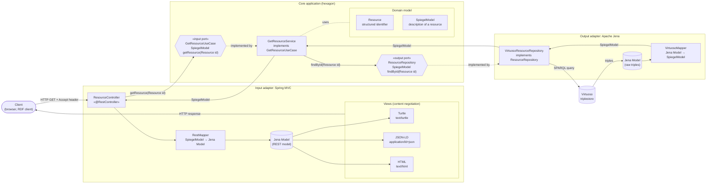

# Hexagonal architecture

Overview of the core application (the hexagon) with one input port and one output port, and one concrete adapter on each side.

## Flow

1. The **client** sends an HTTP request to the `ResourceController`; the `Accept` header determines the representation it wants.
2. The `ResourceController` builds a `Resource` (structured identifier) and calls the input port `GetResourceUseCase.getResource(Resource id)`.
3. The core application asks the output port `ResourceRepository.findById(Resource id)` for the description of that resource.
4. `VirtuosoResourceRepository`, the concrete implementation of `ResourceRepository`, queries the triplestore with Apache Jena. The raw triples arrive in a Jena `Model`.
5. `VirtuosoMapper` maps that Jena `Model` to a `SpiegelModel`, which is returned to the hexagon.
6. The hexagon returns the `SpiegelModel` to the `ResourceController`.
7. `RestMapper` maps the `SpiegelModel` back to a Jena `Model`, the REST model.
8. Based on content negotiation, the controller selects the view that renders the Jena `Model`: an RDF serialisation (Turtle, JSON-LD) or an HTML representation.

The core depends only on its own model (`SpiegelModel`, `Resource`) and its ports; Apache Jena appears only in the adapters.
